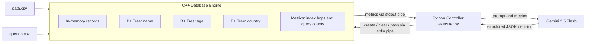

# 🧠 AI-Driven Adaptive Indexing Engine

> A mini in-memory database written from scratch in C++ with hand-built **B+ Trees**, controlled in real time by an **LLM (Google Gemini) acting as an autonomous Database Administrator**. The LLM watches live workload metrics and decides which indexes to build or drop, under a strict RAM budget.
<!-- 


 -->

---

## 📌 Table of Contents
1. [What I Built](#-what-i-built)
2. [How It Works](#-how-it-works)
3. [Architecture](#-architecture)
4. [Project Structure](#-project-structure)
5. [How to Run](#-how-to-run)
6. [Data & Query Format](#-data--query-format)
7. [Key Design Decisions](#-key-design-decisions)
8. [Real-World Applications](#-real-world-applications)
9. [Tech Stack](#-tech-stack)
10. [Known Limitations](#-known-limitations)
11. [Future Improvements](#-future-improvements)
12. [Skills Demonstrated](#-skills-demonstrated)

---

## 🔨 What I Built

Databases are fast because of **indexes**, but indexes cost memory, and you can't index everything. Normally a human DBA decides what to index by watching the workload. This project automates that decision with an LLM.

The system has two cooperating programs:

| Component | Language | Role |
|---|---|---|
| **Database engine** (`database_final.cpp`) | C++ | Loads records into memory, builds/destroys B+ Tree indexes, answers point and range queries, and tracks performance metrics |
| **AI controller** (`executer.py`) | Python | Launches the engine, reads its metrics, asks Gemini what to do, and sends the decision back |

The table has three columns: **name**, **age**, **country**. Each one can have its own B+ Tree index, but **only two indexes may live in RAM at once**. The AI has to work out which two are worth keeping for the current workload.

---

## ⚙️ How It Works

1. **Data ingestion.** The engine reads `data.csv` (900 records) and stores every record in memory as a `person` struct (`name`, `age`, `country`).
2. **Start with no indexes.** At first, every query is answered by a **full linear scan** of all records. This is the slow baseline.
3. **Query stream.** The engine reads `queries.csv` line by line. Each query is either a **point query** (`p`, exact match) or a **range query** (`r`, `from` to `to`) on one column.
4. **Metric tracking.** For every query, the engine counts **"index hops"**, meaning how many nodes or records it had to touch. It also counts how many queries hit each column.
5. **Batch checkpoint.** After every batch of **100 queries**, the engine prints its metrics to stdout:
   ```
   name_vis: 1800 age_vis: 90000 country_vis: 450
   name_q_ct: 12 age_q_ct: 70 country_q_ct: 18
   current graphs: name
   ```
6. **LLM decision.** `executer.py` reads these lines through a pipe and sends them to **Gemini 2.5 Flash** together with the rules (max 2 indexes, avoid pointless rebuilds). Gemini replies with schema-constrained JSON, for example:
   ```json
   {"action1": "create", "target1": "age", "action2": "clear", "target2": "name"}
   ```
7. **Apply the action.** The Python controller writes the decision back to the engine's stdin. The engine then **builds** or **destroys** the requested B+ Trees on the fly. Queries on indexed columns now run in `O(log n)`, and the rest still use linear scans.
8. **Safety guard.** If the AI ever leaves three indexes alive, the engine detects the violation and aborts. This simulates an out-of-memory crash.
9. **Report.** At the end, the engine prints total runtime and the number of AI calls to `stderr`.

---

## 🏗 Architecture



The two processes talk over **OS pipes** (`subprocess.Popen` with stdin/stdout). This is a simple, language-agnostic IPC design.

---

## 📁 Project Structure

```
.
├── database_final.cpp   # Core engine: B+ Tree, query execution, metrics, action handler
├── executer.py          # Python orchestrator + Gemini integration
├── data_generator.cpp   # Generates synthetic data.csv (900 records)
├── query_generator.cpp  # Generates synthetic queries.csv (200 mixed queries)
├── data.csv             # Sample dataset
├── queries.csv          # Sample workload
└── README.md
```

---

## 🚀 How to Run

### Prerequisites
- A C++ compiler with C++17 support (`g++`)
- Python 3.9+
- A [Gemini API key](https://aistudio.google.com/apikey)

### Steps

**1. Download the Google GenAI SDK**
```bash
pip install google-genai
```

**2. Set your API key**

The SDK reads it from the environment.
```bash
# Linux / macOS
export GEMINI_API_KEY="your_api_key_here"

# Windows (PowerShell)
$env:GEMINI_API_KEY="your_api_key_here"

# Windows (cmd)
set GEMINI_API_KEY=your_api_key_here
```

**3. Compile the database engine**

`executer.py` launches an executable named `database`, so keep that name.
```bash
g++ -std=c++17 -O2 database_final.cpp -o database
```

**4. (Optional) Regenerate the data and workload**
```bash
g++ -O2 data_generator.cpp -o data_generator && ./data_generator
g++ -O2 query_generator.cpp -o query_generator && ./query_generator
```

**5. Run the project**
```bash
py executer.py          # Windows
python3 executer.py     # Linux / macOS
```

You will see the metrics coming from the engine, the parsed JSON from Gemini, the final `LLM DECISION`, and the engine's run-time summary.

> ⚠️ Run everything from the same folder, because the engine looks for `data.csv` and `queries.csv` in its working directory.

---

## 📄 Data & Query Format

**`data.csv`**: `name,age,country`
```
fnh,97,dc
gki,16,ad
```

**`queries.csv`**: `type,column,value[,upper_value]`

| Example | Meaning |
|---|---|
| `p,age,16` | Point query: everyone aged exactly 16 |
| `r,age,8,206` | Range query: ages from 8 to 206 |
| `p,name,ckb` | Point query on name |
| `r,country,ee,ee` | Range query on country |

The generators produce a **randomized, skewed workload** so the AI has a real pattern to adapt to.

---

## 🧩 Key Design Decisions

- **B+ Tree built from scratch, with no STL tree.** It is a templated `bpnode<key>` that handles both `int` (age) and `string` (name, country). Order is configurable (`M = 4`).
- **Linked leaf nodes.** Range queries find the first matching leaf, then walk sideways through `next_leaf` pointers. They never re-descend from the root.
- **Duplicate key support.** Each key maps to a `vector<person*>`, so many people can share the same age or country.
- **Node splitting** on insert is implemented for both leaf and internal nodes, including root growth.
- **Fair, measurable metric.** "Index hops" counts node visits for tree lookups and record comparisons for linear scans. The AI sees one consistent unit of cost across both paths.
- **Hard resource constraint.** The 2-index limit forces real trade-offs, because the AI has to decide what to evict.
- **Structured LLM output.** Gemini is called with a **JSON schema and `temperature=0`**, using enums for the allowed actions and targets. This makes the output deterministic and parseable, so the engine never has to handle free-form text.
- **Graceful fallback.** If the response can't be parsed, the controller sends `pass name pass name` (a no-op) instead of crashing.
- **Memory hygiene.** Trees are fully freed on `clear` and again at shutdown.

---

## 🌍 Real-World Applications

This project is a small-scale model of a real, active research and industry area.

- **Self-tuning / autonomous databases.** Oracle Autonomous Database, Azure SQL Automatic Tuning, and research systems like OtterTune all try to manage indexes and configuration automatically.
- **Workload-aware caching.** The same idea (decide what to keep in limited fast memory based on live traffic) applies to CDN caches, Redis eviction policies, and query-result caches.
- **Cost reduction in cloud DBs.** Indexes consume RAM, storage, and write throughput. Dropping unused ones and building the right ones saves real money.
- **Search and analytics backends.** Systems that answer range queries (time-series, logs, geospatial, e-commerce filters) rely on B+ Tree-style indexes.
- **Reducing DBA toil.** Teams without a dedicated DBA can get reasonable index recommendations automatically.
- **LLM-as-controller pattern.** Letting an LLM observe metrics and emit **constrained, machine-readable actions** is the core pattern behind AI agents and AIOps tools.

---

## 🛠 Tech Stack

| Layer | Technology |
|---|---|
| Storage engine | **C++17** (STL, templates, manual memory management) |
| Index structure | **B+ Tree** (custom implementation) |
| Orchestration | **Python 3** (`subprocess`, pipes) |
| AI model | **Google Gemini 2.5 Flash** via the `google-genai` SDK |
| LLM technique | Structured output (JSON schema), system prompting, `temperature=0` |
| IPC | Anonymous pipes (stdin/stdout) |
| Data generation | C++ `mt19937` random generators |

---

## ⚠️ Known Limitations

Being upfront about these shows engineering judgment, and they double as the roadmap below.

- **Reactive, not predictive.** Decisions are made on the last batch only, with no trend or seasonality awareness.
- **Indexes are rebuilt from scratch** on every `create`. There is no incremental or background build.
- **Read-only workload.** There is no `INSERT`, `UPDATE`, or `DELETE` after load, so index maintenance cost isn't modeled.
- **Hard-coded schema** (`name`, `age`, `country`).
- **LLM latency and cost.** Every decision is a network call, and there is no local fallback policy.
- **Small scale.** The dataset is 900 rows, and the B+ Tree order is tiny (4) to keep it easy to inspect and debug.
- **With the default 200-query workload and batch size of 100**, the AI gets only a small number of decision points. Larger workloads show adaptation much more clearly.

---

## 🔮 Future Improvements

**Engine**
- [ ] Full CRUD with B+ Tree **deletion, node merging, and rebalancing**
- [ ] **Composite (multi-column) indexes**
- [ ] **Disk-backed pages** with a buffer pool (LRU), so it becomes a real storage engine rather than an in-memory one
- [ ] A basic **SQL parser** (`SELECT ... WHERE age BETWEEN ...`)
- [ ] **Concurrency** with multi-threaded queries and read-write locks
- [ ] A **cost-based query planner** that chooses between index scan and full scan
- [ ] Generic schema loaded from a config or header row

**AI layer**
- [ ] **Baseline comparison**: no-index, static-index, rule-based, and LLM policies, with charts
- [ ] Give the LLM **history** (last N batches) so it can spot trends
- [ ] **Reinforcement learning** or a bandit algorithm as a cheaper, faster alternative to LLM calls
- [ ] Add **index build cost** and **memory footprint** to the prompt so the AI can reason about ROI
- [ ] **Hybrid policy**: a fast heuristic by default, calling the LLM only when the workload shifts
- [ ] Validate and **auto-repair invalid decisions** before applying them, so the crash guard never triggers
- [ ] Support other models (OpenAI, Claude, local models via Ollama)

**Engineering**
- [ ] `Makefile` / CMake and Docker setup
- [ ] Unit tests for B+ Tree correctness (compare against `std::map`)
- [ ] Benchmark suite and live dashboard (Streamlit or Grafana)
- [ ] CI with GitHub Actions

---

## 💼 Skills Demonstrated

- **Data structures and algorithms:** implemented a templated B+ Tree with splitting, duplicate handling, and linked-leaf range scans
- **Systems programming:** C++ memory management, process spawning, and inter-process communication over pipes
- **Database internals:** indexing, query cost, access paths, and resource-constrained optimization
- **Applied AI / LLM engineering:** prompt design, structured outputs, deterministic decoding, and error handling for model responses
- **Software design:** a clean separation between the engine (mechanism) and the controller (policy), which makes the policy swappable
- **Performance measurement:** a custom metric for comparing linear-scan cost against index-lookup cost

---

## 📬 Author

**Pragam Dixit**
[LinkedIn](https://linkedin.com/in/pragamdixit) · [GitHub](https://github.com/pragamdt)

---

⭐ If you found this project interesting, consider giving it a star!